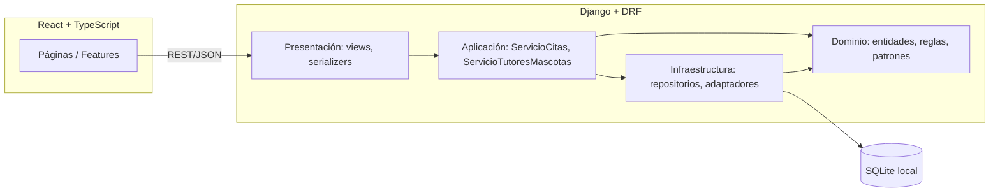
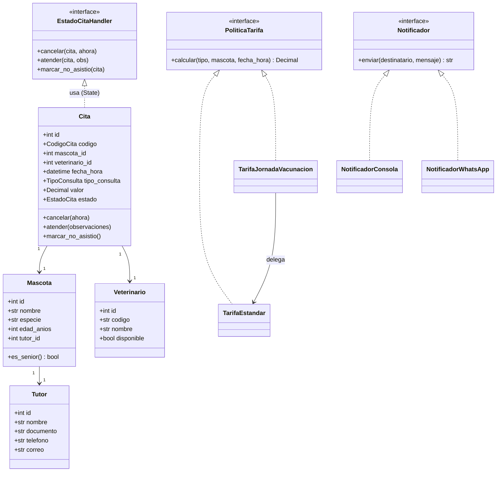
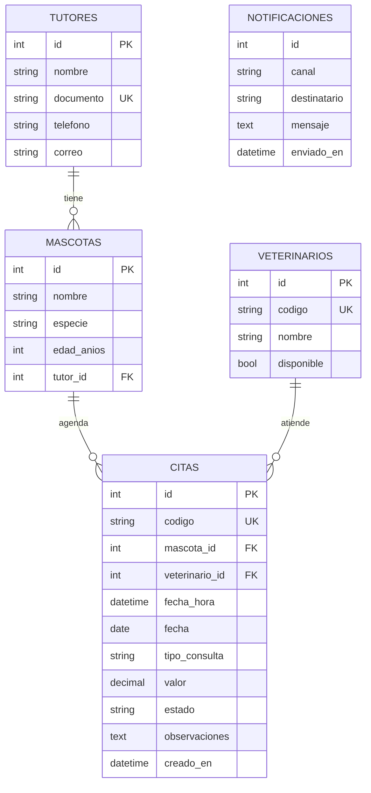
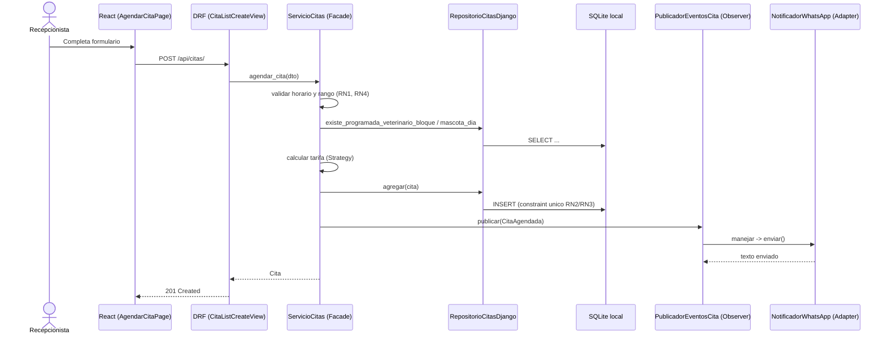
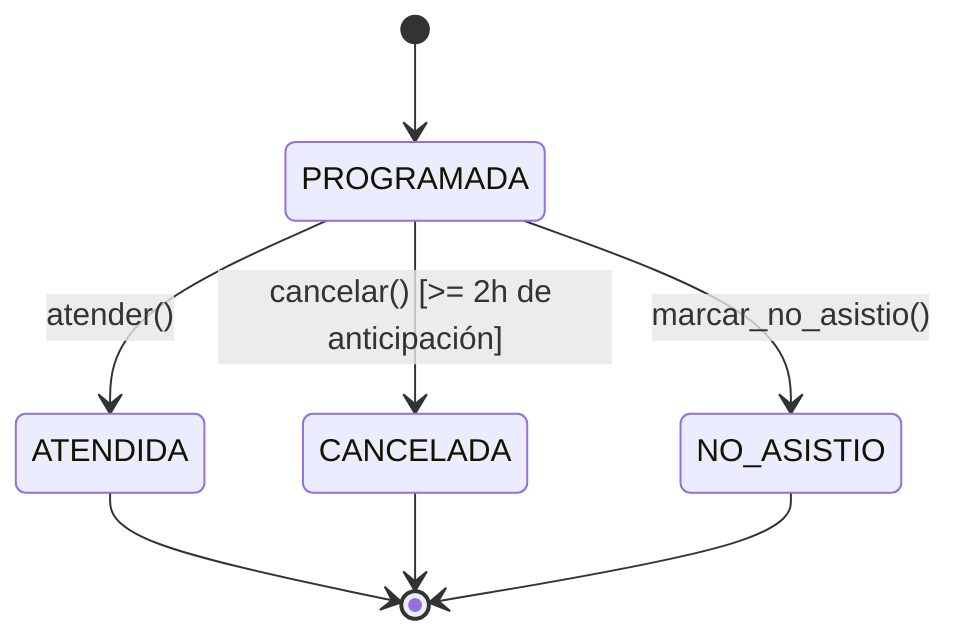

# Clínica Veterinaria Huellitas — Sistema Web de Citas

Sistema web completo para la gestión de citas de la clínica veterinaria **Huellitas**: backend en
Django + Django REST Framework con Clean Architecture, frontend en React + TypeScript y base de
datos SQLite local por defecto. PostgreSQL está disponible como alternativa.

## Tabla de contenido

1. [Descripción y objetivos](#descripción-y-objetivos)
2. [Stack tecnológico](#stack-tecnológico)
3. [Arquitectura](#arquitectura)
4. [Diagramas](#diagramas)
5. [Patrones de diseño](#patrones-de-diseño)
6. [Principios SOLID aplicados](#principios-solid-aplicados)
7. [Reglas de negocio](#reglas-de-negocio)
8. [Casos de uso](#casos-de-uso)
9. [Escenario de cambio](#escenario-de-cambio)
10. [Endpoints de la API](#endpoints-de-la-api)
11. [Instalación y ejecución](#instalación-y-ejecución)
12. [Pruebas](#pruebas)
13. [Matriz de trazabilidad](#matriz-de-trazabilidad)
14. [Limitaciones conocidas](#limitaciones-conocidas)

## Descripción y objetivos

Huellitas necesita reemplazar su agenda manual de citas por un sistema web que:

- Permita registrar tutores y sus mascotas.
- Agende citas respetando el horario de atención, la disponibilidad del veterinario y las reglas
  de tarifas vigentes.
- Permita cancelar, atender y marcar inasistencias sobre esas citas, con trazabilidad de estados.
- Notifique al tutor cuando una cita se agenda o se cancela.
- Ofrezca un panel administrativo con historial, agenda diaria y un dashboard operativo.

## Stack tecnológico

| Capa | Tecnología |
| --- | --- |
| Backend | Python 3.13, Django 5.1, Django REST Framework, drf-spectacular (OpenAPI) |
| Base de datos local | SQLite |
| Base de datos alternativa | PostgreSQL 16 |
| Pruebas backend | pytest, pytest-django |
| Frontend | React 18, TypeScript, Vite, React Router, Axios, React Hook Form, Zod, Tailwind CSS |
| Ejecución local | Python, Node.js y npm |

## Arquitectura

El backend sigue **Clean Architecture** estricta: el dominio no importa Django, DRF ni PostgreSQL.

```
backend/
├── domain/            # Entidades, enums, reglas puras, puertos (interfaces), patrones Strategy/State/Observer
├── application/        # Servicios de aplicación (fachadas de los casos de uso), DTOs
├── infrastructure/      # Repositorios Django ORM, adaptadores de notificación, fábricas, DI
├── apps/               # Apps Django: solo modelos, serializers, views y urls (presentación + persistencia)
│   ├── tutores/
│   ├── mascotas/
│   ├── veterinarios/
│   ├── citas/
│   └── notificaciones/
├── tests/              # Pruebas unitarias y de integración
└── config/             # Settings, urls raíz, wsgi/asgi
```

Regla de dependencia: `apps` y `infrastructure` dependen de `application` y `domain`; nunca al revés.
`domain` no importa nada de las demás capas.

El frontend refleja la misma separación:

```
frontend/src/
├── domain/          # Tipos y enums que reflejan el dominio del backend
├── application/     # Hooks que orquestan llamadas a la API para cada feature
├── infrastructure/  # Cliente HTTP (axios) y módulos de API por recurso
├── components/      # UI compartida (layout, formularios, tablas, modales, feedback)
├── features/        # Páginas por módulo (dashboard, tutores, mascotas, veterinarios, citas)
└── routes/          # Definición de rutas
```

## Diagramas

### Componentes



### Diagrama de clases (dominio, simplificado)



### Entidad-relación



### Secuencia: agendar cita (CU2)



### Estados de una cita (State)



## Patrones de diseño

| Patrón | Dónde | Por qué |
| --- | --- | --- |
| **Strategy** | `domain/tarifas.py` (`PoliticaTarifa`, `TarifaEstandar`, `TarifaJornadaVacunacion`) | Permite agregar la tarifa de jornada de vacunación sin modificar `ServicioCitas`. |
| **State** | `domain/estados.py` (`EstadoCitaHandler` y subclases) | Encapsula las transiciones válidas de una cita (RN8) y rechaza las inválidas sin condicionales dispersos. |
| **Observer** | `domain/eventos.py` (`PublicadorEventosCita`) + `domain/observadores.py` | `ServicioCitas` publica eventos de agendamiento/cancelación sin conocer el mecanismo de notificación. |
| **Adapter** | `infrastructure/notificadores.py` (`NotificadorConsola`, `NotificadorWhatsApp`) | Cada canal de notificación implementa el mismo puerto `Notificador`; agregar un canal nuevo no afecta al dominio. |
| **Facade** | `application/servicio_citas.py` (`ServicioCitas`) | Único punto de entrada para CU2–CU6; las vistas no conocen las reglas de negocio. |
| **Factory Method** | `infrastructure/fabricas.py` | Elige la implementación concreta de notificador y de política de tarifa según variables de entorno. |
| **Repository** | `domain/ports.py` + `infrastructure/repositorios/*` | Abstrae el acceso a datos; el dominio no conoce el ORM. |
| **Dependency Injection** | `infrastructure/container.py` | Construye los servicios de aplicación inyectando las implementaciones concretas. |
| **DTO** | `application/dto.py` + serializers DRF | Separan los contratos de entrada/salida de la API del modelo de dominio. |

No se implementó ningún patrón adicional "porque la lista lo pedía": por ejemplo, no hay un
Repository separado para lecturas simples de veterinarios con filtros complejos, ni un Command
para operaciones que ya son triviales con el Facade.

## Principios SOLID aplicados

- **SRP**: cada capa tiene una responsabilidad (dominio = reglas, aplicación = orquestación,
  infraestructura = detalles técnicos, presentación = HTTP).
- **OCP**: `TarifaJornadaVacunacion` y `NotificadorWhatsApp` se añadieron sin tocar
  `ServicioCitas` ni los demás adaptadores.
- **LSP**: cualquier `PoliticaTarifa`, `Notificador` o `EstadoCitaHandler` es intercambiable sin
  romper el código que los consume.
- **ISP**: los puertos (`RepositorioCitas`, `Notificador`, `Reloj`, etc.) son interfaces pequeñas
  y específicas, no una interfaz "god object".
- **DIP**: `application` depende de abstracciones (`domain/ports.py`); `infrastructure` provee las
  implementaciones concretas, inyectadas en `infrastructure/container.py`.

## Reglas de negocio

| # | Regla | Implementación |
| --- | --- | --- |
| RN1 | Horario lunes a sábado, 8:00–17:00, bloques de 30 min | `domain/reglas_horario.py` |
| RN2 | Un veterinario no puede tener dos citas PROGRAMADA en el mismo bloque | Chequeo en `ServicioCitas` + `UniqueConstraint` condicional en `CitaModel` |
| RN3 | Una mascota no puede tener dos citas PROGRAMADA el mismo día | Idem, con `UniqueConstraint` sobre `(mascota, fecha)` |
| RN4 | Solo citas futuras, máximo 30 días de anticipación | `domain/reglas_horario.py` |
| RN5 | Cancelar solo con ≥ 2 horas de anticipación | `domain/estados.py` (`ProgramadaState.cancelar`) |
| RN6 | Tarifas por tipo de consulta + 10% descuento senior (≥10 años) | `domain/tarifas.py` (`TarifaEstandar`) |
| RN7 | Código único `VET-AAAAMMDD-NNN` | `domain/value_objects.py` (`CodigoCita`) |
| RN8 | Solo PROGRAMADA puede cambiar de estado; los demás son finales | `domain/estados.py` (State) |
| RN9 | Notificar al tutor al agendar/cancelar | `domain/eventos.py` + `domain/observadores.py` (Observer) |

## Casos de uso

| CU | Descripción | Reglas | Prioridad | Semana | API / pantalla web |
| --- | --- | --- | --- | --- | --- |
| CU1 | Registrar tutor y mascota | — | Alta | 14 | `POST /api/tutores/`, `POST /api/mascotas/`; `/tutores`, `/mascotas` |
| CU2 | Agendar cita | RN1, RN2, RN3, RN4, RN6, RN7, RN9 | Alta | 14 | `POST /api/citas/`; `/citas/agendar` |
| CU3 | Consultar agenda diaria de un veterinario | — | Alta | 14 | `GET /api/citas/agenda/`; `/agenda` |
| CU4 | Cancelar cita | RN5, RN9 | Alta | 14 | `POST /api/citas/{id}/cancelar/`; acción en `/citas` |
| CU5 | Atender cita y registrar observaciones | RN8 | Media | 15 | `POST /api/citas/{id}/atender/`; acción en `/citas` |
| CU6 | Marcar cita como NO_ASISTIO | RN8 | Media | 15 | `POST /api/citas/{id}/no-asistio/`; acción en `/citas` |

## Atributos de calidad priorizados

| Prioridad | Atributo | Cómo se satisface |
| --- | --- | --- |
| 1 | Modificabilidad | `ServicioCitas` depende de `PoliticaTarifa` y `Notificador`; las fábricas seleccionan implementaciones sin cambiar el servicio. |
| 2 | Testeabilidad | El puerto `Reloj` se sustituye por `RelojFijo` en pruebas; las reglas del dominio se prueban sin usar la consola. |
| 3 | Integridad de datos | `Cita` delega cambios a handlers de estado y la base de datos refuerza la unicidad de las citas programadas. |
| 4 | Usabilidad básica | La consola traduce entradas inválidas a instrucciones en español y muestra las citas con sus IDs antes de las acciones. |

## Escenario de cambio

La aplicación web es la interfaz principal para realizar los casos de uso. La configuración
predeterminada usa la política de tarifa estándar (`estandar`); el adaptador `consola` registra el
mensaje de notificación en la terminal donde corre Django, mientras la interfaz muestra confirmación
al usuario. La consola interactiva de Django queda disponible como herramienta opcional y comparte
la misma base de datos SQLite que la API.

Ambos cambios se incorporaron **sin modificar `ServicioCitas`**:

1. **Jornada de vacunación** (sábados, VACUNACION con 20% de descuento, sin acumular con el
   descuento senior): nueva clase `TarifaJornadaVacunacion` en `domain/tarifas.py`, activada por la
   variable de entorno `POLITICA_TARIFA=jornada_vacunacion` a través de
   `infrastructure/fabricas.py`.
2. **Notificaciones por WhatsApp** (formato `[WhatsApp a <telefono>] <mensaje>`, simulado): nueva
   clase `NotificadorWhatsApp` en `infrastructure/notificadores.py`, activada por
   `NOTIFICACION_CANAL=whatsapp`.

## Endpoints de la API

Documentación interactiva: `GET /api/docs/` (Swagger) y `GET /api/redoc/` (Redoc), generadas por
drf-spectacular a partir de `GET /api/schema/`.

| Método | Endpoint | Descripción |
| --- | --- | --- |
| GET/POST | `/api/tutores/` | Listar / registrar tutores |
| GET/POST | `/api/mascotas/` | Listar (filtro `tutor_id`) / registrar mascotas |
| GET | `/api/mascotas/{id}/` | Detalle de una mascota |
| GET | `/api/veterinarios/` | Listar veterinarios |
| GET | `/api/veterinarios/{id}/` | Detalle de un veterinario |
| GET/POST | `/api/citas/` | Listar (filtros `fecha`, `veterinario_id`, `mascota_id`, `estado`) / agendar citas |
| GET | `/api/citas/{id}/` | Detalle de una cita |
| GET | `/api/citas/agenda/?veterinario_id=&fecha=` | Agenda diaria (CU3) |
| GET | `/api/citas/dashboard/?fecha=` | Estadísticas para el dashboard |
| POST | `/api/citas/{id}/cancelar/` | Cancelar cita (CU4) |
| POST | `/api/citas/{id}/atender/` | Atender cita (CU5) |
| POST | `/api/citas/{id}/no-asistio/` | Marcar inasistencia (CU6) |

El estado de una cita **nunca** se expone como campo editable vía `PATCH`; solo cambia a través de
los endpoints de acción explícitos.

## Instalación y ejecución

No se necesita Docker ni instalar un servidor de base de datos. Se requiere Python 3.13 y Node.js
con npm.

### Backend y base de datos local

Desde PowerShell, en la raíz del proyecto:

```powershell
Copy-Item .env.example .env
Set-Location backend
python -m venv .venv
.\.venv\Scripts\Activate.ps1
pip install -r requirements.txt
python manage.py migrate
python manage.py runserver 127.0.0.1:8000
```

La base de datos SQLite se crea en `backend/db.sqlite3` al ejecutar las migraciones. Estas también
precargan los veterinarios VET-01 y VET-02.

El backend queda disponible en http://127.0.0.1:8000/ y la documentación en
http://127.0.0.1:8000/api/docs/.

### Consola interactiva opcional

Desde `backend/`, con el entorno virtual activado y las migraciones aplicadas:

```powershell
python manage.py consola
```

El menú permite registrar y consultar tutores y mascotas, listar veterinarios, agendar citas,
cancelarlas, atenderlas, marcar inasistencias y consultar agenda, filtros y detalle de citas. Para
agendar, introduce la fecha como `AAAA-MM-DD HH:MM`; el sistema valida horario, disponibilidad,
anticipación y reglas de la mascota. Las notificaciones de agenda y cancelación se imprimen en la
misma consola. La opción `0` cierra el menú.

### Frontend local

En otra terminal de PowerShell, desde la raíz del proyecto:

```powershell
Set-Location frontend
Copy-Item .env.example .env
npm install
npm run dev
```

El frontend queda disponible en http://localhost:5173/.

### PostgreSQL local (opcional)

SQLite es la configuración predeterminada. Si ya tienes PostgreSQL instalado y quieres usarlo,
configura `DJANGO_DB_ENGINE=postgresql` y las variables `POSTGRES_DB`, `POSTGRES_USER`,
`POSTGRES_PASSWORD`, `POSTGRES_HOST` y `POSTGRES_PORT` en el archivo `.env`.

## Pruebas

```powershell
Set-Location backend
.\.venv\Scripts\python.exe -m pytest -v
```

La suite cubre:

- **Dominio puro** (`tests/test_dominio.py`): reglas de horario, tarifas (estándar y jornada de
  vacunación), transiciones de estado, `CodigoCita` — sin base de datos.
- **Casos de uso con base de datos** (`tests/test_servicio_citas.py`): los 10 criterios de
  aceptación (CA1–CA10), notificaciones (Observer + Adapter) y filtros.
- **CU1 y veterinarios precargados** (`tests/test_servicio_tutores_mascotas.py`).
- **API REST de extremo a extremo** (`tests/test_api.py`): registro, agendamiento, agenda,
  cancelación, atención e inasistencia vía `APIClient`; manejo de errores HTTP y bloqueo de
  `PATCH` arbitrario sobre el estado. El reloj se fija durante estas pruebas para que las reglas
  de fechas no dependan del día en que se ejecuta la suite.

Un **reloj inyectable** (`domain/ports.Reloj`, con `RelojFijo` en pruebas y `RelojSistema` en
producción) desacopla las pruebas de la fecha real del sistema.

Para validar también el frontend, en otra terminal desde la raíz:

```powershell
Set-Location frontend
npm run lint
npm run build
```

`lint` ejecuta la verificación de TypeScript y `build` verifica TypeScript y genera la versión de
producción de Vite.

## Matriz de trazabilidad

| Requisito | Dominio/Aplicación | Infraestructura/Presentación | Pruebas |
| --- | --- | --- | --- |
| RN1 Horario | `domain/reglas_horario.py` | `apps/citas/views.py` (valida vía `ServicioCitas`) | `test_dominio.py::TestReglasHorario`, CA3 |
| RN2 Veterinario ocupado | `application/servicio_citas.py` | `UniqueConstraint` en `CitaModel` | CA4 |
| RN3 Mascota mismo día | `application/servicio_citas.py` | `UniqueConstraint` en `CitaModel` | CA5 |
| RN4 Rango de fechas | `domain/reglas_horario.py` | — | CA6 |
| RN5 Cancelación ≥2h | `domain/estados.py` | `infrastructure/unidad_de_trabajo.py` (lock) | CA7, CA8 |
| RN6 Tarifas | `domain/tarifas.py` | `infrastructure/fabricas.py` | CA1, CA2 |
| RN7 Código único | `domain/value_objects.py` | `apps/citas/models.py` (`unique=True`) | `test_dominio.py::TestCodigoCita` |
| RN8 Transiciones | `domain/estados.py` | — | CA9, pruebas de estados |
| RN9 Notificaciones | `domain/eventos.py`, `domain/observadores.py` | `infrastructure/notificadores.py` | `TestNotificacionesYEventos` |
| CU1–CU6 | `application/*.py` | `apps/*/views.py` | `test_servicio_*.py`, `test_api.py` |
| Cambio 1 (jornada vacunación) | `domain/tarifas.py` | `infrastructure/fabricas.py` (config) | `TestTarifaJornadaVacunacion` |
| Cambio 2 (WhatsApp) | `domain/observadores.py` | `infrastructure/notificadores.py` | `test_formato_adaptador_whatsapp_real` |

## Limitaciones conocidas

- Los endpoints de listado (`/api/tutores/`, `/api/mascotas/`) usan paginación (20 por página); los
  selectores del frontend (por ejemplo, el formulario de agendamiento) muestran solo la primera
  página. Para un volumen de datos mayor al de una demo, conviene agregar búsqueda server-side
  (`?search=`) en esos selectores.
- No hay autenticación/autorización todavía: el sistema asume un panel administrativo interno de
  un solo rol (recepción/veterinario). Añadir Django's auth + permisos de DRF es el siguiente paso
  natural para producción.
- El canal WhatsApp es una simulación funcional (no se integra un proveedor real como Twilio o
  Meta Cloud API); el puerto `Notificador` ya está listo para ese reemplazo sin tocar el dominio.
